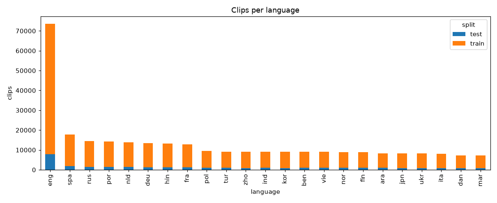
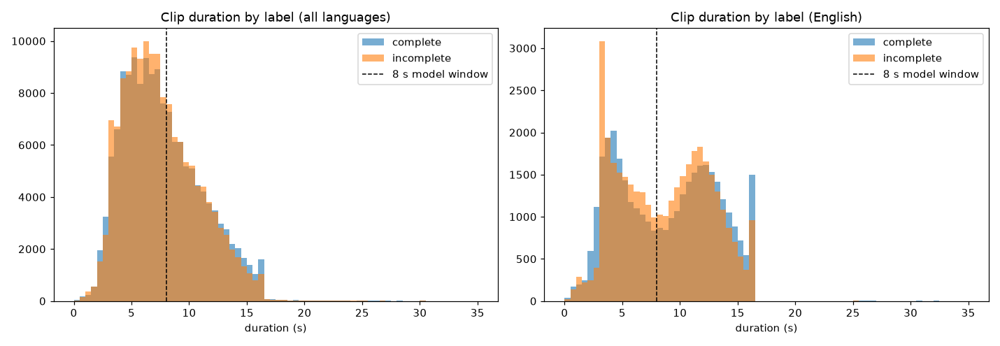
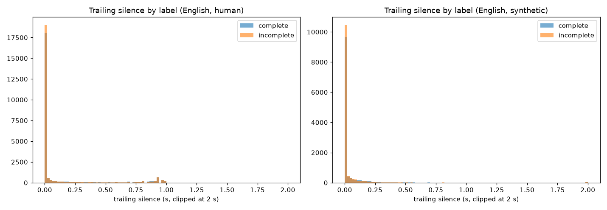

# smart-turn-data-v3.2 and the training splits: dataset exploration

Generated by `python scripts/explore_dataset.py` on 2026-10-24 from 302,473 rows (pipecat-ai/smart-turn-data-v3.2-train, pipecat-ai/smart-turn-data-v3.2-test), plus mavleo96/turn-detection-data for the splits. Full tables: `tables/*.csv`.

## Task spec vs. measured

| claim | spec | measured (all rows) |
|---|---|---|
| English share | ~24% | 24.3% |
| complete share (labels) | ~50% | 49.6% |
| synthetic share | ~83% | 82.3% |
| endfiller null share | ~20% | 20.7% |
| clip length range | 0.4-33 s | 0.20-45.3 s |
| median clip length | ~7 s | 7.12 s |

## Id and text checks

- Duplicate ids within a split: {'train': 0, 'test': 0}
- Ids present in both splits: 0
- Rows with non-empty `spoken_text`: 0

## Overview

| split | rows | languages | sources | english_share | complete_share | synthetic_share | hours |
|---|---|---|---|---|---|---|---|
| train | 270,946 | 23 | 12 | 0.243 | 0.496 | 0.824 | 576 |
| test | 31,527 | 23 | 12 | 0.248 | 0.498 | 0.814 | 67.3 |

## Languages (top 25)

| language | train | test | share | complete_share | synthetic_share | sources | median_duration_s |
|---|---|---|---|---|---|---|---|
| eng | 65,802 | 7,820 | 0.243 | 0.493 | 0.335 | 10 | 8.92 |
| spa | 16,033 | 1,783 | 0.0589 | 0.495 | 0.748 | 2 | 6.92 |
| rus | 12,966 | 1,468 | 0.0477 | 0.496 | 1 | 1 | 7.12 |
| por | 12,792 | 1,398 | 0.0469 | 0.492 | 1 | 1 | 8.12 |
| nld | 12,518 | 1,398 | 0.046 | 0.501 | 1 | 1 | 6.8 |
| deu | 12,058 | 1,322 | 0.0442 | 0.496 | 1 | 1 | 6.92 |
| hin | 12,006 | 1,284 | 0.0439 | 0.495 | 1 | 1 | 5.52 |
| fra | 11,511 | 1,252 | 0.0422 | 0.496 | 1 | 1 | 6.76 |
| pol | 8,497 | 974 | 0.0313 | 0.489 | 1 | 1 | 7.36 |
| tur | 8,213 | 966 | 0.0303 | 0.499 | 1 | 1 | 6.04 |
| ind | 8,089 | 971 | 0.03 | 0.499 | 1 | 1 | 7.2 |
| zho | 8,159 | 929 | 0.03 | 0.498 | 1 | 1 | 8.88 |
| kor | 8,164 | 889 | 0.0299 | 0.499 | 1 | 1 | 6.32 |
| ben | 8,006 | 1,000 | 0.0298 | 0.5 | 1 | 1 | 6.68 |
| vie | 7,991 | 1,004 | 0.0297 | 0.499 | 1 | 1 | 6.4 |
| nor | 7,972 | 1,014 | 0.0297 | 0.498 | 1 | 1 | 6.72 |
| fin | 7,939 | 1,010 | 0.0296 | 0.5 | 1 | 1 | 7 |
| ara | 7,396 | 947 | 0.0276 | 0.501 | 1 | 1 | 7.92 |
| jpn | 7,389 | 834 | 0.0272 | 0.5 | 1 | 1 | 7.72 |
| ukr | 7,280 | 929 | 0.0271 | 0.502 | 1 | 1 | 6 |
| ita | 7,192 | 782 | 0.0264 | 0.491 | 1 | 1 | 8.48 |
| dan | 6,558 | 779 | 0.0243 | 0.496 | 1 | 1 | 6.16 |
| mar | 6,415 | 774 | 0.0238 | 0.494 | 1 | 1 | 4.88 |

## Sources

| dataset | train | test | languages | english | synthetic_share | complete_share |
|---|---|---|---|---|---|---|
| chirp3_1 | 146,627 | 16,254 | 14 | 14,586 | 1 | 0.496 |
| chirp3_2 | 67,646 | 8,428 | 9 | 0 | 1 | 0.499 |
| liva_1 | 30,922 | 3,831 | 1 | 34,753 | 0 | 0.499 |
| midcentury_1 | 8,489 | 1,044 | 1 | 9,533 | 0 | 0.483 |
| mundo_1 | 3,986 | 496 | 1 | 0 | 0 | 0.499 |
| human_5 | 3,527 | 402 | 1 | 3,929 | 0 | 0.508 |
| rime_2 | 3,505 | 394 | 1 | 3,899 | 1 | 0.454 |
| orpheus_endfiller_1 | 1,661 | 181 | 1 | 1,842 | 1 | 0.486 |
| orpheus_grammar_1 | 1,570 | 163 | 1 | 1,733 | 1 | 0.517 |
| orpheus_midfiller_1 | 1,542 | 140 | 1 | 1,682 | 1 | 0.493 |
| chirp3_3_short | 792 | 104 | 1 | 896 | 1 | 0.432 |
| human_convcollector_1 | 679 | 90 | 1 | 769 | 0 | 0.469 |

## English: sources

| dataset | train | test | synthetic_share | complete_share_train | complete_share_test |
|---|---|---|---|---|---|
| liva_1 | 30,922 | 3,831 | 0 | 0.498 | 0.503 |
| chirp3_1 | 13,115 | 1,471 | 1 | 0.493 | 0.496 |
| midcentury_1 | 8,489 | 1,044 | 0 | 0.483 | 0.483 |
| human_5 | 3,527 | 402 | 0 | 0.516 | 0.443 |
| rime_2 | 3,505 | 394 | 1 | 0.457 | 0.424 |
| orpheus_endfiller_1 | 1,661 | 181 | 1 | 0.484 | 0.508 |
| orpheus_grammar_1 | 1,570 | 163 | 1 | 0.517 | 0.521 |
| orpheus_midfiller_1 | 1,542 | 140 | 1 | 0.497 | 0.45 |
| chirp3_3_short | 792 | 104 | 1 | 0.428 | 0.462 |
| human_convcollector_1 | 679 | 90 | 0 | 0.476 | 0.422 |

## English: labels by human / synthetic

| split | label | human | synthetic | All |
|---|---|---|---|---|
| test | complete | 2,649 | 1,184 | 3,833 |
| test | incomplete | 2,718 | 1,269 | 3,987 |
| train | complete | 21,652 | 10,791 | 32,443 |
| train | incomplete | 21,965 | 11,394 | 33,359 |
| All |  | 48,984 | 24,638 | 73,622 |

## English: midfiller (incl. nulls)

| midfiller | test / complete | test / incomplete | train / complete | train / incomplete |
|---|---|---|---|---|
| False | 243 | 263 | 2,266 | 2,431 |
| None | 3,056 | 3,189 | 25,637 | 26,258 |
| True | 534 | 535 | 4,540 | 4,670 |

## English: endfiller (incl. nulls)

| endfiller | test / complete | test / incomplete | train / complete | train / incomplete |
|---|---|---|---|---|
| False | 777 | 296 | 6,806 | 2,426 |
| None | 3,056 | 3,189 | 25,637 | 26,258 |
| True | 0 | 502 | 0 | 4,675 |

## Null counts

| column | train | test |
|---|---|---|
| id | 0 | 0 |
| language | 0 | 0 |
| endpoint_bool | 0 | 0 |
| midfiller | 55,881 | 6,741 |
| endfiller | 55,881 | 6,741 |
| synthetic | 0 | 0 |
| spoken_text | 270,946 | 31,527 |
| dataset | 0 | 0 |

## Duration by language (top 25)

| language | count | mean | min | 5% | 50% | 95% | max | > 8 s |
|---|---|---|---|---|---|---|---|---|
| eng | 73,622 | 8.73 | 0.24 | 3 | 8.92 | 15.4 | 45.3 | 0.547 |
| spa | 17,816 | 7.22 | 0.36 | 2.74 | 6.92 | 13 | 15.9 | 0.344 |
| rus | 14,434 | 7.51 | 1.16 | 3.6 | 7.12 | 13 | 15.9 | 0.373 |
| por | 14,190 | 8.38 | 0.2 | 4 | 8.12 | 13.8 | 15.9 | 0.515 |
| nld | 13,916 | 7.14 | 0.72 | 3.64 | 6.8 | 11.8 | 15.9 | 0.323 |
| deu | 13,380 | 7.29 | 0.72 | 3.6 | 6.92 | 12.4 | 15.9 | 0.346 |
| hin | 13,290 | 5.96 | 1.44 | 2.88 | 5.52 | 10.4 | 15.8 | 0.177 |
| fra | 12,763 | 7.09 | 0.76 | 3.32 | 6.76 | 12.1 | 15.9 | 0.328 |
| pol | 9,471 | 7.68 | 0.76 | 3.52 | 7.36 | 13.2 | 15.9 | 0.409 |
| tur | 9,179 | 6.55 | 1.2 | 2.92 | 6.04 | 12.1 | 15.9 | 0.254 |
| zho | 9,088 | 9.21 | 1.24 | 5.68 | 8.88 | 14.1 | 15.9 | 0.615 |
| ind | 9,060 | 7.58 | 1.04 | 3.64 | 7.2 | 12.7 | 30.7 | 0.384 |
| kor | 9,053 | 6.81 | 1.48 | 3.64 | 6.32 | 11.8 | 15.9 | 0.275 |
| ben | 9,006 | 7.18 | 1.36 | 3.16 | 6.68 | 13 | 28.5 | 0.337 |
| vie | 8,995 | 6.67 | 0.52 | 2.92 | 6.4 | 11.4 | 30 | 0.272 |
| nor | 8,986 | 7 | 1.2 | 3.4 | 6.72 | 11.5 | 26.5 | 0.31 |
| fin | 8,949 | 7.49 | 0.8 | 3.36 | 7 | 13.2 | 30 | 0.37 |
| ara | 8,343 | 8.57 | 1.16 | 3.16 | 7.92 | 16.2 | 30 | 0.49 |
| jpn | 8,223 | 8.16 | 1.16 | 4.32 | 7.72 | 13.7 | 15.9 | 0.454 |
| ukr | 8,209 | 6.58 | 1.6 | 2.92 | 6 | 11.9 | 38 | 0.247 |
| ita | 7,974 | 8.69 | 1.08 | 3.99 | 8.48 | 14.1 | 15.9 | 0.56 |
| dan | 7,337 | 6.51 | 0.8 | 2.8 | 6.16 | 11.6 | 23.8 | 0.244 |
| mar | 7,189 | 5.39 | 1.4 | 2.56 | 4.88 | 9.76 | 20.2 | 0.129 |

## English: duration by split, label, kind

| split | label | kind | count | mean | min | 5% | 50% | 95% | max | > 8 s |
|---|---|---|---|---|---|---|---|---|---|---|
| test | complete | human | 2,649 | 9.84 | 0.849 | 2.93 | 11.3 | 16 | 30.6 | 0.66 |
| test | complete | synthetic | 1,184 | 7.15 | 0.36 | 2.22 | 6.97 | 12.5 | 15.6 | 0.361 |
| test | incomplete | human | 2,718 | 9.41 | 0.988 | 3.08 | 10.7 | 15.4 | 16 | 0.645 |
| test | incomplete | synthetic | 1,269 | 6.91 | 0.44 | 2 | 6.76 | 11.9 | 15.8 | 0.327 |
| train | complete | human | 21,652 | 9.68 | 0.372 | 2.85 | 11 | 16 | 32.6 | 0.648 |
| train | complete | synthetic | 10,791 | 7.11 | 0.28 | 2.5 | 6.83 | 12.5 | 15.9 | 0.353 |
| train | incomplete | human | 21,965 | 9.5 | 0.57 | 3.12 | 10.7 | 15.6 | 45.3 | 0.656 |
| train | incomplete | synthetic | 11,394 | 6.9 | 0.24 | 2.16 | 6.7 | 12.1 | 15.9 | 0.322 |

## English: duration by source

| dataset | count | mean | min | 5% | 50% | 95% | max | > 8 s |
|---|---|---|---|---|---|---|---|---|
| liva_1 | 34,753 | 11.9 | 1.63 | 5.77 | 12.1 | 16 | 45.3 | 0.915 |
| chirp3_1 | 14,586 | 7.97 | 0.4 | 3.76 | 7.64 | 13.2 | 15.9 | 0.456 |
| midcentury_1 | 9,533 | 3.92 | 1.72 | 2.86 | 3.71 | 5.67 | 14.3 | 0.002 |
| human_5 | 3,929 | 4.47 | 1.3 | 2.34 | 4.26 | 7.33 | 14 | 0.033 |
| rime_2 | 3,899 | 5.93 | 0.813 | 3.19 | 5.85 | 8.93 | 13.6 | 0.124 |
| orpheus_endfiller_1 | 1,842 | 5.9 | 0.853 | 2.39 | 5.63 | 10.3 | 11.9 | 0.213 |
| orpheus_grammar_1 | 1,733 | 5.75 | 1.02 | 2.1 | 5.55 | 10.2 | 11.9 | 0.188 |
| orpheus_midfiller_1 | 1,682 | 6.69 | 1.71 | 3.33 | 6.57 | 10.8 | 11.9 | 0.277 |
| chirp3_3_short | 896 | 1.18 | 0.24 | 0.48 | 1.12 | 2 | 6.52 | 0 |
| human_convcollector_1 | 769 | 3.24 | 0.372 | 1.1 | 3.09 | 5.84 | 7.95 | 0 |

## English: trailing silence by label and kind

| label | kind | count | 10% | 50% | 90% | >= 100 ms | >= 200 ms | >= 500 ms |
|---|---|---|---|---|---|---|---|---|
| complete | human | 24,301 | 0 | 0 | 0.74 | 0.2 | 0.172 | 0.13 |
| complete | synthetic | 11,975 | 0 | 0 | 0.08 | 0.0991 | 0.0468 | 0.0138 |
| incomplete | human | 24,683 | 0 | 0 | 0.62 | 0.175 | 0.15 | 0.113 |
| incomplete | synthetic | 12,663 | 0 | 0 | 0.06 | 0.0787 | 0.0389 | 0.0135 |

## English: median trailing silence by source

| dataset | complete | incomplete |
|---|---|---|
| chirp3_1 | 0 | 0 |
| chirp3_3_short | 0 | 0 |
| human_5 | 0 | 0 |
| human_convcollector_1 | 0 | 0 |
| liva_1 | 0 | 0 |
| midcentury_1 | 0 | 0 |
| orpheus_endfiller_1 | 0 | 0 |
| orpheus_grammar_1 | 0 | 0 |
| orpheus_midfiller_1 | 0 | 0 |
| rime_2 | 0 | 0 |

## Anomalies

| check | train (all) | train (eng) | test (all) | test (eng) | example ids |
|---|---|---|---|---|---|
| decode error | 0 | 0 | 0 | 0 |  |
| empty audio | 0 | 0 | 0 | 0 |  |
| very short (< 1 s) | 345 | 315 | 50 | 48 | 00c85b74-cb38-4222-b043-8a525eb0a0e9, 01194aa4-1055-44f9-b935-d3173ebb1ef0, 016dfe8e-5a81-4b51-a3d8-df97fd13ec66 |
| clipping (> 0.1% of samples) | 5 | 0 | 1 | 0 | 01cce49f-eac7-4067-8c97-ca137f3bf1eb, 58670565-25ff-4be2-8663-5e324362f0b4, 8540f428-4429-4afe-81ac-6df5147da18c |
| near-silent (peak < 0.01) | 0 | 0 | 0 | 0 |  |
| not mono | 0 | 0 | 0 | 0 |  |

## Sample rates

| sample_rate | test | train |
|---|---|---|
| 16,000 | 31,527 | 270,946 |

## Channels

| channels | test | train |
|---|---|---|
| 1 | 31,527 | 270,946 |

## Splits (load_split; smart-turn English + TTD)

| split | clips | hours | complete | dur_mean | dur_p10 | dur_p50 | dur_p90 | dur_max | > 8 s (cropped) | < 1 s |
|---|---|---|---|---|---|---|---|---|---|---|
| train | 386,177 | 684 | 0.502 | 6.38 | 1.13 | 4.03 | 14.3 | 45.3 | 0.273 | 0.073 |
| validation | 43,477 | 78.5 | 0.499 | 6.5 | 1.13 | 4.08 | 14.5 | 32.1 | 0.271 | 0.075 |
| test | 68,394 | 109 | 0.516 | 5.73 | 1.1 | 3.66 | 12.8 | 30.6 | 0.224 | 0.075 |
| excluded (holdout) | 7,032 | 10.1 | 0.487 | 5.19 | 2.95 | 5.02 | 7.64 | 14 | 0.077 | 0 |

## Splits by corpus

| split | corpus | clips | hours | complete | dur_mean | dur_p10 | dur_p50 | dur_p90 | dur_max | > 8 s (cropped) | < 1 s |
|---|---|---|---|---|---|---|---|---|---|---|---|
| train | smart-turn | 52,893 | 134 | 0.493 | 9.15 | 3.44 | 9.8 | 14.4 | 45.3 | 0.603 | 0.005 |
| train | ttd | 333,284 | 550 | 0.504 | 5.94 | 1.07 | 3.5 | 14.2 | 30 | 0.221 | 0.083 |
| validation | smart-turn | 5,877 | 14.8 | 0.504 | 9.05 | 3.43 | 9.6 | 14.4 | 32.1 | 0.594 | 0.005 |
| validation | ttd | 37,600 | 63.7 | 0.498 | 6.1 | 1.04 | 3.56 | 14.6 | 30 | 0.221 | 0.086 |
| test | smart-turn | 7,820 | 19.1 | 0.49 | 8.81 | 3.37 | 9.2 | 14.2 | 30.6 | 0.555 | 0.006 |
| test | ttd | 60,574 | 89.8 | 0.52 | 5.34 | 1.07 | 3.28 | 11.8 | 30 | 0.181 | 0.084 |
| excluded (holdout) | smart-turn | 7,032 | 10.1 | 0.487 | 5.19 | 2.95 | 5.02 | 7.64 | 14 | 0.077 | 0 |

## Splits by source

| split | corpus | source | clips | hours | complete | dur_mean | dur_p10 | dur_p50 | dur_p90 | dur_max | > 8 s (cropped) | < 1 s |
|---|---|---|---|---|---|---|---|---|---|---|---|---|
| train | smart-turn | chirp3_1 | 11,762 | 26 | 0.491 | 7.95 | 4.48 | 7.64 | 12 | 15.9 | 0.454 | 0 |
| train | smart-turn | chirp3_3_short | 704 | 0.234 | 0.42 | 1.19 | 0.6 | 1.16 | 1.8 | 6.52 | 0 | 0.355 |
| train | smart-turn | human_convcollector_1 | 608 | 0.55 | 0.482 | 3.26 | 1.37 | 3.13 | 5.21 | 7.6 | 0 | 0.048 |
| train | smart-turn | liva_1 | 27,893 | 92 | 0.497 | 11.9 | 8.63 | 12.1 | 15.4 | 45.3 | 0.916 | 0 |
| train | smart-turn | midcentury_1 | 7,624 | 8.3 | 0.483 | 3.92 | 3.02 | 3.71 | 5.12 | 14.3 | 0.002 | 0 |
| train | smart-turn | orpheus_endfiller_1 | 1,495 | 2.44 | 0.49 | 5.88 | 2.82 | 5.63 | 9.3 | 11.9 | 0.211 | 0.001 |
| train | smart-turn | orpheus_grammar_1 | 1,399 | 2.24 | 0.51 | 5.76 | 2.73 | 5.55 | 9.15 | 11.9 | 0.187 | 0 |
| train | smart-turn | orpheus_midfiller_1 | 1,408 | 2.62 | 0.498 | 6.69 | 3.81 | 6.57 | 9.9 | 11.9 | 0.278 | 0 |
| train | ttd | seamless | 165,908 | 368 | 0.425 | 7.99 | 1.1 | 4.81 | 20.9 | 30 | 0.339 | 0.076 |
| train | ttd | spokenwoz | 167,376 | 182 | 0.582 | 3.91 | 1.04 | 2.83 | 8.14 | 30 | 0.104 | 0.091 |
| validation | smart-turn | chirp3_1 | 1,353 | 3.01 | 0.511 | 8.01 | 4.6 | 7.68 | 11.9 | 15.9 | 0.465 | 0 |
| validation | smart-turn | chirp3_3_short | 88 | 0.029 | 0.489 | 1.21 | 0.576 | 1.12 | 1.97 | 2.76 | 0 | 0.33 |
| validation | smart-turn | human_convcollector_1 | 71 | 0.063 | 0.423 | 3.18 | 1.55 | 2.98 | 4.73 | 7.95 | 0 | 0 |
| validation | smart-turn | liva_1 | 3,029 | 9.92 | 0.511 | 11.8 | 8.25 | 12 | 15.5 | 32.1 | 0.907 | 0 |
| validation | smart-turn | midcentury_1 | 865 | 0.939 | 0.477 | 3.91 | 3.02 | 3.72 | 5.05 | 7.88 | 0 | 0 |
| validation | smart-turn | orpheus_endfiller_1 | 166 | 0.28 | 0.428 | 6.07 | 3.24 | 5.72 | 9.64 | 11.9 | 0.229 | 0 |
| validation | smart-turn | orpheus_grammar_1 | 171 | 0.285 | 0.573 | 6 | 2.73 | 5.89 | 9.64 | 11.9 | 0.222 | 0 |
| validation | smart-turn | orpheus_midfiller_1 | 134 | 0.246 | 0.493 | 6.6 | 3.84 | 6.23 | 9.73 | 11.9 | 0.284 | 0 |
| validation | ttd | seamless | 17,090 | 41.4 | 0.405 | 8.72 | 1.13 | 5.23 | 25.1 | 30 | 0.363 | 0.077 |
| validation | ttd | spokenwoz | 20,510 | 22.3 | 0.575 | 3.92 | 1 | 2.86 | 8.04 | 30 | 0.102 | 0.093 |
| test | smart-turn | chirp3_1 | 1,471 | 3.29 | 0.496 | 8.04 | 4.68 | 7.72 | 11.9 | 15.8 | 0.464 | 0 |
| test | smart-turn | chirp3_3_short | 104 | 0.031 | 0.462 | 1.09 | 0.52 | 1.04 | 1.67 | 2.12 | 0 | 0.423 |
| test | smart-turn | human_5 | 402 | 0.509 | 0.443 | 4.56 | 2.69 | 4.32 | 6.68 | 10.1 | 0.032 | 0 |
| test | smart-turn | human_convcollector_1 | 90 | 0.08 | 0.422 | 3.19 | 1.29 | 2.85 | 5.52 | 7.83 | 0 | 0.044 |
| test | smart-turn | liva_1 | 3,831 | 12.6 | 0.504 | 11.9 | 8.47 | 12.2 | 15.3 | 30.6 | 0.91 | 0 |
| test | smart-turn | midcentury_1 | 1,044 | 1.13 | 0.483 | 3.9 | 3.02 | 3.69 | 5.1 | 12.9 | 0.001 | 0 |
| test | smart-turn | orpheus_endfiller_1 | 181 | 0.299 | 0.508 | 5.94 | 2.99 | 5.72 | 9.39 | 11.9 | 0.215 | 0 |
| test | smart-turn | orpheus_grammar_1 | 163 | 0.246 | 0.521 | 5.43 | 2.68 | 4.78 | 9.32 | 11.8 | 0.166 | 0 |
| test | smart-turn | orpheus_midfiller_1 | 140 | 0.264 | 0.45 | 6.79 | 3.82 | 6.91 | 9.81 | 11.7 | 0.257 | 0 |
| test | smart-turn | rime_2 | 394 | 0.659 | 0.424 | 6.03 | 3.76 | 5.85 | 8.41 | 11.7 | 0.147 | 0 |
| test | ttd | seamless | 20,221 | 46.3 | 0.406 | 8.25 | 1.1 | 5 | 22.3 | 30 | 0.346 | 0.075 |
| test | ttd | spokenwoz | 40,353 | 43.5 | 0.577 | 3.88 | 1.04 | 2.86 | 7.95 | 30 | 0.099 | 0.089 |
| excluded (holdout) | smart-turn | human_5 | 3,527 | 4.37 | 0.516 | 4.46 | 2.62 | 4.24 | 6.54 | 14 | 0.033 | 0 |
| excluded (holdout) | smart-turn | rime_2 | 3,505 | 5.77 | 0.457 | 5.92 | 3.7 | 5.84 | 8.21 | 13.6 | 0.122 | 0 |

## Splits by --datasets choice

| --datasets | split | smart-turn share | clips | hours | complete | dur_mean | dur_p10 | dur_p50 | dur_p90 | dur_max | > 8 s (cropped) | < 1 s |
|---|---|---|---|---|---|---|---|---|---|---|---|---|
| both | train | 0.137 | 386,177 | 684 | 0.502 | 6.38 | 1.13 | 4.03 | 14.3 | 45.3 | 0.273 | 0.073 |
| both | validation | 0.135 | 43,477 | 78.5 | 0.499 | 6.5 | 1.13 | 4.08 | 14.5 | 32.1 | 0.271 | 0.075 |
| both | test | 0.114 | 68,394 | 109 | 0.516 | 5.73 | 1.1 | 3.66 | 12.8 | 30.6 | 0.224 | 0.075 |
| smart-turn | train | 1 | 52,893 | 134 | 0.493 | 9.15 | 3.44 | 9.8 | 14.4 | 45.3 | 0.603 | 0.005 |
| smart-turn | validation | 1 | 5,877 | 14.8 | 0.504 | 9.05 | 3.43 | 9.6 | 14.4 | 32.1 | 0.594 | 0.005 |
| smart-turn | test | 1 | 7,820 | 19.1 | 0.49 | 8.81 | 3.37 | 9.2 | 14.2 | 30.6 | 0.555 | 0.006 |
| ttd | train | 0 | 333,284 | 550 | 0.504 | 5.94 | 1.07 | 3.5 | 14.2 | 30 | 0.221 | 0.083 |
| ttd | validation | 0 | 37,600 | 63.7 | 0.498 | 6.1 | 1.04 | 3.56 | 14.6 | 30 | 0.221 | 0.086 |
| ttd | test | 0 | 60,574 | 89.8 | 0.52 | 5.34 | 1.07 | 3.28 | 11.8 | 30 | 0.181 | 0.084 |

## Clip length by source and label

| corpus | source | is_complete | clips | hours | complete | dur_mean | dur_p10 | dur_p50 | dur_p90 | dur_max | > 8 s (cropped) | < 1 s |
|---|---|---|---|---|---|---|---|---|---|---|---|---|
| smart-turn | chirp3_1 | 0 | 7,390 | 16.1 | 0 | 7.83 | 4.4 | 7.52 | 11.7 | 15.9 | 0.433 | 0.001 |
| smart-turn | chirp3_1 | 1 | 7,196 | 16.2 | 1 | 8.11 | 4.56 | 7.84 | 12.1 | 15.9 | 0.48 | 0 |
| smart-turn | chirp3_3_short | 0 | 509 | 0.18 | 0 | 1.27 | 0.72 | 1.2 | 1.88 | 6.52 | 0 | 0.289 |
| smart-turn | chirp3_3_short | 1 | 387 | 0.114 | 1 | 1.06 | 0.52 | 1.04 | 1.64 | 2.76 | 0 | 0.455 |
| smart-turn | human_5 | 0 | 1,931 | 2.72 | 0 | 5.07 | 3.36 | 4.82 | 7.15 | 14 | 0.055 | 0 |
| smart-turn | human_5 | 1 | 1,998 | 2.16 | 1 | 3.89 | 2.35 | 3.65 | 5.75 | 11.6 | 0.012 | 0 |
| smart-turn | human_convcollector_1 | 0 | 408 | 0.368 | 0 | 3.25 | 1.55 | 3.05 | 5.15 | 7.6 | 0 | 0.007 |
| smart-turn | human_convcollector_1 | 1 | 361 | 0.325 | 1 | 3.24 | 1.15 | 3.12 | 5.42 | 7.95 | 0 | 0.083 |
| smart-turn | liva_1 | 0 | 17,414 | 56.7 | 0 | 11.7 | 8.74 | 11.9 | 15 | 45.3 | 0.921 | 0 |
| smart-turn | liva_1 | 1 | 17,339 | 57.9 | 1 | 12 | 8.35 | 12.4 | 15.8 | 32.6 | 0.908 | 0 |
| smart-turn | midcentury_1 | 0 | 4,930 | 5.3 | 0 | 3.87 | 3.05 | 3.54 | 5.14 | 7.99 | 0 | 0 |
| smart-turn | midcentury_1 | 1 | 4,603 | 5.08 | 1 | 3.97 | 2.85 | 3.92 | 5.08 | 14.3 | 0.004 | 0 |
| smart-turn | orpheus_endfiller_1 | 0 | 946 | 1.52 | 0 | 5.78 | 2.86 | 5.55 | 9.13 | 11.9 | 0.2 | 0 |
| smart-turn | orpheus_endfiller_1 | 1 | 896 | 1.5 | 1 | 6.04 | 2.9 | 5.72 | 9.6 | 11.9 | 0.228 | 0.001 |
| smart-turn | orpheus_grammar_1 | 0 | 837 | 1.28 | 0 | 5.5 | 2.48 | 5.21 | 8.91 | 11.9 | 0.167 | 0 |
| smart-turn | orpheus_grammar_1 | 1 | 896 | 1.49 | 1 | 5.99 | 2.99 | 5.8 | 9.47 | 11.9 | 0.208 | 0 |
| smart-turn | orpheus_midfiller_1 | 0 | 852 | 1.5 | 0 | 6.34 | 3.5 | 6.23 | 9.47 | 11.9 | 0.229 | 0 |
| smart-turn | orpheus_midfiller_1 | 1 | 830 | 1.63 | 1 | 7.06 | 4.35 | 6.91 | 10.2 | 11.9 | 0.327 | 0 |
| smart-turn | rime_2 | 0 | 2,129 | 3.73 | 0 | 6.3 | 4.16 | 6.2 | 8.58 | 13.6 | 0.17 | 0 |
| smart-turn | rime_2 | 1 | 1,770 | 2.7 | 1 | 5.49 | 3.39 | 5.46 | 7.63 | 11.8 | 0.069 | 0.001 |
| ttd | seamless | 0 | 117,587 | 269 | 0 | 8.23 | 1.26 | 5.23 | 21.1 | 30 | 0.352 | 0.056 |
| ttd | seamless | 1 | 85,632 | 187 | 1 | 7.86 | 0.972 | 4.36 | 21.8 | 30 | 0.327 | 0.103 |
| ttd | spokenwoz | 0 | 95,830 | 111 | 0 | 4.19 | 0.94 | 3.05 | 8.91 | 30 | 0.127 | 0.112 |
| ttd | spokenwoz | 1 | 132,409 | 136 | 1 | 3.7 | 1.13 | 2.73 | 7.44 | 30 | 0.085 | 0.075 |

## Clip length as a label cue (duration AUC)

| corpus | source | duration AUC |
|---|---|---|
| smart-turn | chirp3_1 | 0.529 |
| smart-turn | chirp3_3_short | 0.375 |
| smart-turn | human_5 | 0.274 |
| smart-turn | human_convcollector_1 | 0.496 |
| smart-turn | liva_1 | 0.549 |
| smart-turn | midcentury_1 | 0.567 |
| smart-turn | orpheus_endfiller_1 | 0.53 |
| smart-turn | orpheus_grammar_1 | 0.558 |
| smart-turn | orpheus_midfiller_1 | 0.591 |
| smart-turn | rime_2 | 0.371 |
| ttd | seamless | 0.462 |
| ttd | spokenwoz | 0.479 |
| smart-turn | (all) | 0.516 |
| ttd | (all) | 0.445 |

## Known limitations

- **Possible leakage across splits:** `spoken_text` is empty, so complete and truncated versions of the same sentence cannot be grouped and may land in different splits (train vs val, or train vs test). Val/test scores may be optimistic.
- **Domain gap:** the data is clean recorded or TTS speech, not phone calls.
- **Trailing silence** is energy-based and relative to each clip's loudest frame (-40 dB, 20 ms frames), so noisy recordings read as less silent than clean TTS.
